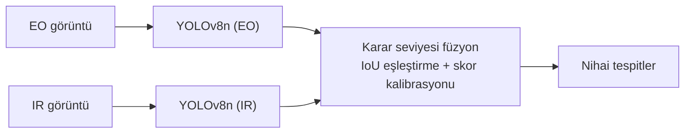

# EO/IR Görüntü Füzyonu ile Düşük Işıkta Hedef Tespiti

Gece ve düşük ışıkta tek bir sensör insan tespiti için yetmiyor. Görünür ışık (EO) kamerası doku ve ayrıntı verir ama aydınlatma olmadan kör kalır. Termal (LWIR) kamera cismin kendi yaydığı ışımayı ölçtüğü için karanlıkta da insanı görür, fakat doku bilgisi zayıftır ve sıcak olan her nesne yanlış alarm üretebilir. Bu proje, iki sensörün tespitlerini karar seviyesinde birleştirmenin tek sensörlü sistemlere göre ne kadar kazandırdığını ölçüyor.

**Durum: devam ediyor (Faz 1).** IR dedektörü eğitildi, EO dedektörü ve füzyon henüz yok. Test setine bu repoda henüz bakılmadı.

## Yaklaşım



- **Veri:** [LLVIP](https://bupt-ai-cz.github.io/LLVIP/). 15.488 zaman ve uzayda hizalı görünür/kızılötesi görüntü çifti, tek sınıf (person), VOC XML etiketleri.
- **Dedektörler:** EO ve IR için ayrı iki YOLOv8n (3,0 milyon parametre), COCO ön-eğitimli ağırlıklardan ince ayar. Ayarlar ve veri bölmesi iki modalitede aynı, tek fark sensör.
- **Füzyon (planlanan):** Her dedektör düşük güven eşiğiyle ham kutular üretir. Kutular IoU ile eşleştirilir, skorlar doğrulama setinde kalibre edilip birleştirilir. Karar seviyesi seçildi çünkü piksel hizalama hatasına toleranslı, modüler ve bir sensör çökse diğeri çalışıyor.

## Durum

- [x] LLVIP indirildi, klasör yapısı ve etiket formatı gerçek dosyalarla doğrulandı
- [x] VOC → YOLO etiket dönüşümü ve görsel doğrulama
- [x] Klip bazlı train/val/test bölmesi ve sızıntı kontrolü
- [x] IR dedektörü (YOLOv8n, 50 epoch, Colab T4)
- [ ] EO dedektörü (aynı ayarlar)
- [ ] Test setinde tek sensörlü baseline'lar (yalnızca EO, yalnızca IR)
- [ ] Karar seviyesi füzyon (IoU eşleştirme, skor kalibrasyonu)
- [ ] Hata analizi: füzyon nerede kazandırıyor, nerede kazandırmıyor
- [ ] Faz 2 (isteğe bağlı): özellik ve piksel seviyesi füzyon

## Veri bölmesi: neden klip bazlı

LLVIP dosya adları `KKFFFF` biçiminde: ilk iki hane klip numarası, son dört hane o kliptaki kare sırası (klip numarası dosya adlarından çıkarıldı, LLVIP belgelerinde ayrıca teyit edilmedi, veri bu varsayımı destekliyor). Resmi train/test ayrımı zaten klip bazlı ayrık. Ben train'in bir kısmını doğrulama (val) için ayırırken önce kareleri rastgele böldüm ve val skorunun şişebileceğinden şüphelendim. `scripts/check_split_leakage.py` ile ölçtüm: val karelerinin **%97,2'si train'de en fazla 1 kare uzaklıktaydı**. Kareler ardışık ve her biri %15 ihtimalle val'e düştüğü için bu oran beklenen değerle (~%97,7) tutarlı. Yani val'deki kare, train'deki bir karenin neredeyse kopyasıydı.

Bölmeyi klip bazında yeniden yaptım. Bir klip ya tamamen train'e ya tamamen val'e gidiyor:

| Küme | Görüntü çifti | Klipler |
|---|---|---|
| Eğitim | 9.921 | 01–04, 07–13, 16–18, 25 |
| Doğrulama | 2.104 | 05, 06, 14, 15 |
| Test | 3.463 | 19–24, 26 (resmi LLVIP test seti) |

IR ve EO için bölme aynı (seed 42). Hangi klipler val'e gitti `splits/split_manifest.json` içinde kayıtlı.

Veri notları: 5 geçersiz kutu (`020118`, `020236`, `090437`, `091180`, `170350`) dönüşümde otomatik atlandı. Kaynak veride iki görüntü baştan etiketsiz (`100030`, `100033`), elle bakıldı, ikisinde de insan yok.

## Sonuçlar

**IR dedektörü**, doğrulama kümesi (klip 05, 06, 14, 15; 2.104 görüntü, 6.294 insan), en iyi epoch (35/50):

| Precision | Recall | mAP50 | mAP50-95 |
|---|---|---|---|
| 0,956 | 0,895 | 0,958 | 0,616 |

Bu sayıları okurken:

- En iyi epoch val üzerinde seçildi, yani değer iyimser. Epoch 20-50 arasında mAP50-95 ortalaması 0,607 (std 0,007).
- Val yalnızca dört klip, tek bir sahne skoru fazla oynatabilir.
- **Test seti henüz kullanılmadı.** Genelleme sayısı test'ten gelecek.
- Ayrıntılı eğitim çıktısı: [`results/ir_yolov8n_e50/`](results/ir_yolov8n_e50/).

**EO dedektörü:** henüz eğitilmedi. LLVIP'in EO görüntüleri çok karanlık, bu yüzden IR'ın baskın çıkması ve füzyon kazancının sınırlı kalması olası. Bu bir hipotez, sonuçlar çıkınca olduğu gibi raporlanacak.

## Nasıl çalıştırılır

```bash
pip install -r requirements.txt

# 1) LLVIP'i indir (lisans koşulları için yukarıdaki bağlantı), sonra YOLO formatına çevir ve böl
python3 scripts/prepare_llvip_yolo.py --llvip_root /yol/LLVIP --out_root /yol/output_v2

# 2) Bölmede sızıntı olmadığını doğrula (üç satırın hepsi "yok" demeli)
python3 scripts/check_split_leakage.py --dataset_dir /yol/output_v2/dataset_ir

# 3) Etiketleri görüntünün üstüne çizip gözle kontrol et
python3 scripts/verify_yolo_label.py --dataset_dir /yol/output_v2/dataset_ir --split train --name 010001
```

Eğitim Colab T4 üzerinde, `notebooks/colab_train_yolo.ipynb` ile yapılıyor. Defter IR ve EO için aynı, değişen tek satır `MODALITY`. Veri seti zip'lenip Drive'a yüklenir (`zip -rq0 dataset_ir.zip dataset_ir`), defter onu yerel diske açıp sayıları ve kliplerin ayrıklığını doğrular, sonra eğitir. Eğitim sırasında ağırlıklar Drive'a yazılır, oturum koparsa `RESUME = True` ile devam edilir.

`configs/` altındaki YAML'lar şablon, Colab defteri kendi yolunu üretir.

## Repo yapısı

```
scripts/      veri hazırlama, etiket doğrulama, sızıntı kontrolü
notebooks/    Colab eğitim defteri
configs/      Ultralytics veri YAML şablonları
splits/       kullanılan bölmenin kaydı
results/      eğitim çıktıları (ağırlıklar hariç)
```

Veri seti ve model ağırlıkları repoda yok (`.gitignore`). LLVIP kendi lisansı altında dağıtılıyor (akademik ve ticari olmayan kullanım), indirmeden önce koşulları okuyun.

## Sınırlamalar

- LLVIP sivil bir veri seti (gece yaya tespiti), askeri hedef içermiyor. Yöntem düşük görünürlükte hedef tespiti problemini temsil etmek için seçildi.
- LLVIP görüntü çiftlerini önceden hizaladı. Gerçek bir sistemde farklı konumlu, farklı çözünürlüklü ve zaman olarak senkronize olmayan iki kamera için hizalama ayrı ve zor bir problem.
- Tek sınıf (insan), tek veri seti.

## Ortam

Python 3.13, Ultralytics 8.4.131, OpenCV. PyTorch yerelde 2.13, Colab'da 2.11. Yerel makine Intel Core i5-1235U (CPU), eğitim Google Colab T4 GPU.

## Atıf

Jia et al., *LLVIP: A Visible-infrared Paired Dataset for Low-light Vision*, ICCV Workshops 2021, s. 3489-3497.
