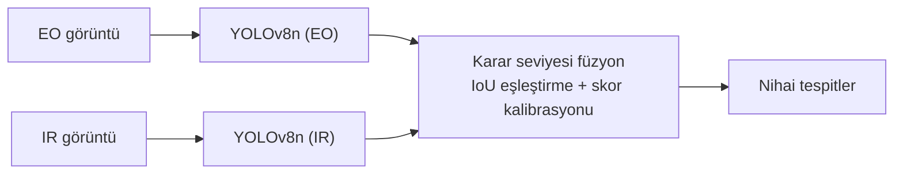

# EO/IR Görüntü Füzyonu ile Düşük Işıkta Hedef Tespiti

Gece ve düşük ışıkta tek bir sensör insan tespiti için yetmiyor. Görünür ışık (EO) kamerası doku ve ayrıntı verir ama aydınlatma olmadan kör kalır. Termal (LWIR) kamera cismin kendi yaydığı ışımayı ölçtüğü için karanlıkta da insanı görür, fakat doku bilgisi zayıftır ve sıcak olan her nesne yanlış alarm üretebilir. Bu proje, iki sensörün tespitlerini karar seviyesinde birleştirmenin tek sensörlü sistemlere göre ne kadar kazandırdığını ölçüyor.

**Durum: devam ediyor (Faz 1).** IR ve EO dedektörleri eğitildi. Ölçüm düzeneği ve füzyon kodu yazıldı ve sentetik veriyle test edildi, gerçek tespitlerle henüz çalıştırılmadı. Test setine bakılmadı.

## Yaklaşım



- **Veri:** [LLVIP](https://bupt-ai-cz.github.io/LLVIP/). 15.488 zaman ve uzayda hizalı görünür/kızılötesi görüntü çifti, tek sınıf (person), VOC XML etiketleri.
- **Dedektörler:** EO ve IR için ayrı iki YOLOv8n (3,0 milyon parametre), COCO ön-eğitimli ağırlıklardan ince ayar. Ayarlar ve veri bölmesi iki modalitede aynı, tek fark sensör.
- **Füzyon (planlanan):** Her dedektör düşük güven eşiğiyle ham kutular üretir. Kutular IoU ile eşleştirilir, skorlar doğrulama setinde kalibre edilip birleştirilir. Karar seviyesi seçildi çünkü piksel hizalama hatasına toleranslı, modüler ve bir sensör çökse diğeri çalışıyor.

## Durum

- [x] LLVIP indirildi, klasör yapısı ve etiket formatı gerçek dosyalarla doğrulandı
- [x] VOC → YOLO etiket dönüşümü ve görsel doğrulama
- [x] Klip bazlı train/val/test bölmesi ve sızıntı kontrolü
- [x] IR dedektörü (YOLOv8n, 50 epoch, Colab T4)
- [x] EO dedektörü (aynı ayarlar). Sonuç dosyaları repoya henüz eklenmedi
- [x] Ölçüm düzeneği: ham tespit kaydı, Ultralytics ile aynı sonucu veren değerlendirici, test koruması
- [x] Füzyon kodu: IoU eşleştirme, Platt kalibrasyonu, kural tabanlı ve öğrenilmiş füzyon, WBF referansı, klip bazlı çapraz doğrulama
- [ ] Sağlama: değerlendirici val'de Ultralytics'in sayılarını tutturuyor mu (gerçek tespitlerle)
- [ ] Füzyonu val'de seç ve dondur (`fusion_config.json`)
- [ ] Test setinde tek seferlik ölçüm: EO, IR, füzyon, WBF
- [ ] Hata analizi: füzyon nerede kazandırıyor, nerede kazandırmıyor
- [ ] Faz 2 (isteğe bağlı): özellik ve piksel seviyesi füzyon

## Veri bölmesi: neden klip bazlı

LLVIP dosya adları `KKFFFF` biçiminde: ilk iki hane klip numarası, son dört hane o kliptaki kare sırası (klip numarası dosya adlarından çıkarıldı, LLVIP belgelerinde ayrıca teyit edilmedi, veri bu varsayımı destekliyor). Resmi train/test ayrımı zaten klip bazlı ayrık. Ben train'in bir kısmını doğrulama (val) için ayırırken önce kareleri rastgele böldüm ve val skorunun şişebileceğinden şüphelendim. `scripts/check_split_leakage.py` ile ölçtüm: val karelerinin **%97,2'si train'de en fazla 1 kare uzaklıktaydı**. Kareler ardışık ve her biri %15 ihtimalle val'e düştüğü için bu oran beklenen değerle (~%97,7) tutarlı. Yani val'deki kare, train'deki bir karenin neredeyse kopyasıydı.

Bölmeyi klip bazında yeniden yaptım. Bir klip ya tamamen train'e ya tamamen val'e gidiyor:

| Küme | Görüntü çifti | Klipler |
|---|---|---|
| Eğitim | 9.921 | 01–04, 07–13, 16–18, 25 |
| Doğrulama | 2.104 | 05, 06, 14, 15 |
| Test | 3.463 | 19–24, 26 (resmi LLVIP test seti) |

IR ve EO için bölme aynı (seed 42). Hangi klipler val'e gitti `splits/split_manifest.json` içinde kayıtlı.

Veri notları: 5 geçersiz kutu (`020118`, `020236`, `090437`, `091180`, `170350`) dönüşümde otomatik atlandı. Kaynak veride iki görüntü baştan etiketsiz (`100030`, `100033`), elle bakıldı, ikisinde de insan yok.

## Sonuçlar

**IR dedektörü**, doğrulama kümesi (klip 05, 06, 14, 15; 2.104 görüntü, 6.294 insan), en iyi epoch (35/50):

| Precision | Recall | mAP50 | mAP50-95 |
|---|---|---|---|
| 0,956 | 0,895 | 0,958 | 0,616 |

Bu sayıları okurken:

- En iyi epoch val üzerinde seçildi, yani değer iyimser. Epoch 20-50 arasında mAP50-95 ortalaması 0,607 (std 0,007).
- Val yalnızca dört klip, tek bir sahne skoru fazla oynatabilir.
- **Test seti henüz kullanılmadı.** Genelleme sayısı test'ten gelecek.
- Ayrıntılı eğitim çıktısı: [`results/ir_yolov8n_e50/`](results/ir_yolov8n_e50/).

**EO dedektörü**, aynı val kümesi, en iyi epoch (33/50): mAP50 0,877, mAP50-95 0,492. IR her iki metrikte önde (8 ve 12 puan). Sonuç klasörü (`results/eo_yolov8n_e50/`) repoya eklenince bu sayılar oradan doğrulanacak.

IR zaten mAP50'de 0,958 olduğu için füzyonun kazanabileceği alan mAP50'de dar. Recall ve kutu hassasiyetinde daha geniş. Bu bir hipotez, ölçüm test setinde yapılacak.

LLVIP'in kendi raporu da aynı yönde: IR, görünür görüntüden daha iyi sonuç veriyor ve IoU eşiği 0,7'yi geçince AP iki modalitede de hızla düşüyor ([LLVIP README](https://github.com/bupt-ai-cz/LLVIP)). Yani mAP50-95'teki düşüşün bir kısmı etiketlerin kendi hassasiyetinden geliyor olabilir, yalnızca modelden değil.

Not: Ultralytics 8.4.131'de `best.pt` seçen fitness yalnızca mAP50-95 (`w = [0, 0, 0, 1]`, `utils/metrics.py`). Eski sürümlerdeki 0,1·mAP50 + 0,9·mAP50-95 burada geçerli değil. IR'da iki formül de aynı epoch'u (35) seçiyor.

## Ölçüm düzeneği ve füzyon

Füzyonun ne kadar kazandırdığını ölçmeden önce ölçüm aletinin kendisi doğrulanmalı. Kod `eoir/` paketinde, komut satırı betikleri `scripts/` altında.

1. **Ham tespitler** (`predict_raw.py`): her dedektör `conf=0.001`, NMS IoU 0,7, en fazla 300 kutu ile çalışır, tüm adaylar orijinal piksel koordinatında (xyxy) JSON'a yazılır. Eşikten geçmemiş kutular da tutulur, çünkü füzyon bir sensörün düşük güvenle gördüğünü diğerinin onayıyla kurtarabilir. Girdi, Ultralytics val ile aynı boyuta getirilir (1280x1024 için 544x640, ortalanmış dolgu). Betik metrik hesaplamaz, test'te de güvenle çalışır.
2. **Değerlendirici** (`evaluate_dets.py`, `eoir/metrics.py`): Ultralytics 8.4.131'in `match_predictions`, `ap_per_class` ve `compute_ap` fonksiyonlarını birebir izler. Bu, Ultralytics'in kaynak kodu çalıştırılarak rastgele verilerde karşılaştırıldı: skorlarda eşitlik yokken fark sıfır. Eşitlik varken sıralama farkından ~1e-3'e kadar sapma oluyor. Baseline'lar ve füzyon hep bu araçla ölçülür. Klip bazlı sonuç ve eşleştirilmiş bootstrap (yöntem farkının güven aralığı) üretir.
3. **Test koruması:** `--split test` yalnızca `--final` ile çalışır. Her ölçüm dosya özetleriyle `results/test_eval_log.jsonl`'e yazılır, aynı dosyanın ikinci kez ölçülmesi engellenir.
4. **Füzyon** (`eoir/fusion.py`):
   - *Kalibrasyon:* her sensörün skoru Platt ölçekleme ile "doğru tespit" olasılığına çevrilir. Tek sensörün mAP'ini değiştirmez, çünkü sıralamayı korur. Etkisi iki sensör birleşirken ortaya çıkar.
   - *Eşleştirme:* EO ve IR kutuları IoU ile bire bir eşlenir, güçlü kutular önce. Eşleşmeyen kutu tek sensörlü tespit olarak kalır.
   - *Skor kuralı:* `max` (birleşim), `mean`, `noisy_or` (bağımsız hata varsayımı), `intersection` (iki sensör de görmeli) ya da `learned` (lojistik regresyon: iki skor, hangi sensörün gördüğü, IoU, kutu alanı).
   - *Kutu kuralı:* `ir`, `score` ya da `weighted`. IR kutuları zaten daha sıkı olduğu için ortalama almanın mAP50-95'i düşürüp düşürmediği ayrıca ölçülür.
   - *Son NMS (isteğe bağlı):* bire bir eşleştirme, aynı sensörden NMS 0,7'yi geçmiş kopya kutuları ayrı tespit olarak bırakır ve bunlar yanlış alarm sayılır. WBF bu kopyaları aynı kümeye katarak yutar. Gerekip gerekmediğine val karar verir. Aynı seçenek baseline'lara da verilir. Aksi halde kazancın füzyondan mı yoksa NMS ayarından mı geldiği ayrılamaz.
   - Görüntü başına en fazla 300 tespit, baseline'larla adil karşılaştırma için.
   - *Referans:* literatürdeki Weighted Boxes Fusion, bağımsız olsun diye `ensemble-boxes` paketinden.
5. **Ayar seçimi** (`tune_fusion.py`, 90 füzyon ayarı, gerçek ölçekli sentetik veride CPU'da yaklaşık 35 dakika): val iki kez kullanıldığı için (epoch seçimi ve füzyon ayarı) 4 val klibiyle bir-klip-dışarıda çapraz doğrulama yapılır. Öğrenilen parçalar 3 klipte öğrenilir, dışarıdaki klipte ölçülür. Birincil ölçüt önceden seçildi: out-of-fold mAP50-95. Seçilen ayar tüm val'de yeniden öğrenilip `fusion_config.json` olarak dondurulur. Karşılaştırma noktası "en iyi tek sensör"dür: IR ve EO, aynı son NMS seçenekleriyle ve aynı ölçütle seçilir (`single_config.json`). Ayrıca en iyi ayarın IR'ı kaç klipte geçtiği ve kalibrasyonun güvenilirlik diyagramı raporlanır.
6. **Uygulama** (`apply_fusion.py`): dondurulmuş ayarı tespit dosyalarına uygular. Hiçbir şey öğrenmez.

## Nasıl çalıştırılır

```bash
pip install -r requirements.txt

# 1) LLVIP'i indir (lisans koşulları için yukarıdaki bağlantı), sonra YOLO formatına çevir ve böl
python3 scripts/prepare_llvip_yolo.py --llvip_root /yol/LLVIP --out_root /yol/output_v2

# 2) Bölmede sızıntı olmadığını doğrula (üç satırın hepsi "yok" demeli)
python3 scripts/check_split_leakage.py --dataset_dir /yol/output_v2/dataset_ir

# 3) Etiketleri görüntünün üstüne çizip gözle kontrol et
python3 scripts/verify_yolo_label.py --dataset_dir /yol/output_v2/dataset_ir --split train --name 010001
```

Testler (sentetik veriyle değerlendirici, füzyon ve uçtan uca betik hattı):

```bash
python3 -m pytest -q tests
```

Eğitim Colab T4 üzerinde, `notebooks/colab_train_yolo.ipynb` ile yapılıyor. Defter IR ve EO için aynı, değişen tek satır `MODALITY`. Veri seti zip'lenip Drive'a yüklenir (`zip -rq0 dataset_ir.zip dataset_ir`), defter onu yerel diske açıp sayıları ve kliplerin ayrıklığını doğrular, sonra eğitir. Eğitim sırasında ağırlıklar Drive'a yazılır, oturum koparsa `RESUME = True` ile devam edilir.

Eğitimden sonra `notebooks/colab_dets_and_fusion.ipynb` sırasıyla şunları yapar: ham tespitleri üretir (GPU), değerlendiriciyi Ultralytics'e karşı sağlar, füzyonu val'de ayarlar. Test hücresi yorum satırı halinde. Aynı adımlar elle:

```bash
# Ham tespitler (her modalite ve bölüm için)
python3 scripts/predict_raw.py --weights ir_best.pt --dataset_dir /yol/dataset_ir --split val --modality ir --out dets/ir_val.json.gz

# Sağlama: Ultralytics'in val sayılarıyla karşılaştır
python3 scripts/evaluate_dets.py --dataset_dir /yol/dataset_ir --split val \
    --dets ir=dets/ir_val.json.gz eo=dets/eo_val.json.gz --expect ir=<mAP50>,<mAP50-95> eo=<...> --per_clip

# Füzyonu val'de seç ve dondur
python3 scripts/tune_fusion.py --dataset_dir /yol/dataset_ir --eo dets/eo_val.json.gz --ir dets/ir_val.json.gz --out_dir results/fusion_val

# Yalnızca her şey dondurulduktan sonra, tek sefer
python3 scripts/apply_fusion.py --config results/fusion_val/fusion_config.json --eo dets/eo_test.json.gz --ir dets/ir_test.json.gz --out dets/fusion_test.json.gz
python3 scripts/apply_fusion.py --config results/fusion_val/single_config.json --eo dets/eo_test.json.gz --ir dets/ir_test.json.gz --out dets/single_test.json.gz
python3 scripts/evaluate_dets.py --dataset_dir /yol/dataset_ir --split test --final \
    --dets ir=dets/ir_test.json.gz eo=dets/eo_test.json.gz single=dets/single_test.json.gz fusion=dets/fusion_test.json.gz --per_clip --bootstrap 1000 --reference single
```

`configs/` altındaki YAML'lar şablon, Colab defteri kendi yolunu üretir.

## Repo yapısı

```
eoir/         ortak kod: tespit dosyası biçimi, değerlendirici, füzyon
scripts/      veri hazırlama, etiket doğrulama, sızıntı kontrolü,
              ham tespit, değerlendirme, füzyon ayarı ve uygulaması
tests/        sentetik veriyle birim ve uçtan uca testler
notebooks/    Colab defterleri (eğitim; tespit + sağlama + füzyon)
configs/      Ultralytics veri YAML şablonları
splits/       kullanılan bölmenin kaydı
results/      eğitim çıktıları (ağırlıklar hariç)
```

Veri seti ve model ağırlıkları repoda yok (`.gitignore`). LLVIP kendi lisansı altında dağıtılıyor (akademik ve ticari olmayan kullanım), indirmeden önce koşulları okuyun.

## Sınırlamalar

- LLVIP sivil bir veri seti (gece yaya tespiti), askeri hedef içermiyor. Yöntem düşük görünürlükte hedef tespiti problemini temsil etmek için seçildi.
- LLVIP görüntü çiftlerini önceden hizaladı. Gerçek bir sistemde farklı konumlu, farklı çözünürlüklü ve zaman olarak senkronize olmayan iki kamera için hizalama ayrı ve zor bir problem.
- Tek sınıf (insan), tek veri seti, yalnızca gece. Gündüz ve termal crossover durumları test edilmiyor.
- LLVIP etiketleri 21.02.2023'te kısmen düzeltildi (eksik yayalar eklendi, bazı kutular iyileştirildi). Bu projede kullanılan sürüm, indirme tarihine göre belirlenmeli ve başka çalışmalarla karşılaştırırken dikkate alınmalı.
- Val dört klip, test yedi klip. Görüntü bazlı bootstrap, aynı klipteki kareler bağımsız olmadığı için belirsizliği olduğundan küçük gösterir, bu yüzden klip bazlı sonuçlarla birlikte okunmalı.

## Ortam

Python 3.13, Ultralytics 8.4.131, OpenCV. PyTorch yerelde 2.13, Colab'da 2.11. Yerel makine Intel Core i5-1235U (CPU), eğitim Google Colab T4 GPU.

## Atıf

Jia et al., *LLVIP: A Visible-infrared Paired Dataset for Low-light Vision*, ICCV Workshops 2021, s. 3489-3497.
